# Stratus

An Android weather app modelled closely on Apple Weather for iPhone: the same layout, the same cards, the same detail sheets and the same animated skies, built with Kotlin and Jetpack Compose. It uses free, open weather data, so it needs no API keys or accounts.

<p>
  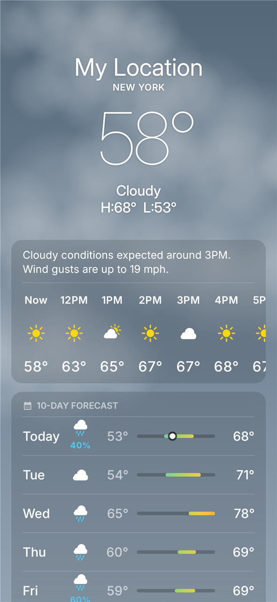
  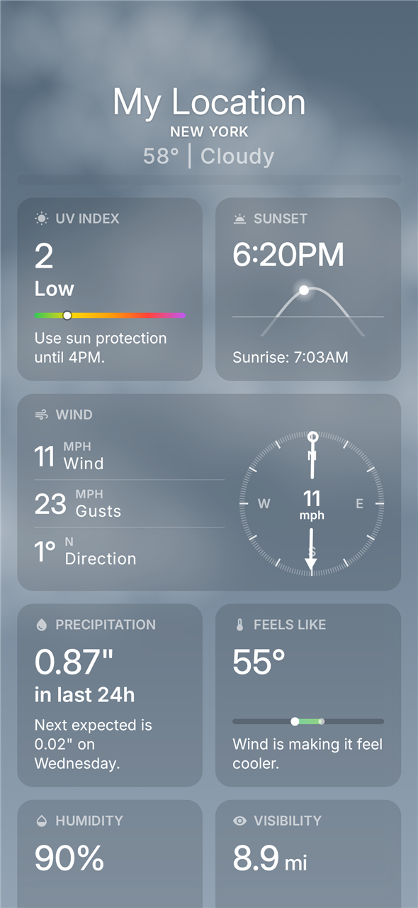
  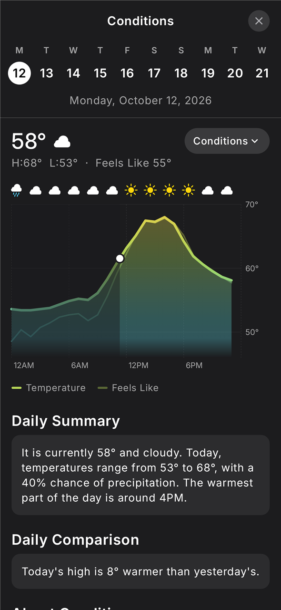
</p>

> Screenshots use sample data for New York City.

## Download

Get the latest APK from [Releases](../../releases) and open it on your phone (allow installing from your browser or file manager when asked). Requires **Android 10 or newer**.

## Features

### Forecast page
- Large current temperature, condition, and today's high and low, with a header that collapses as you scroll, like iOS.
- **Hourly forecast** with a one-line summary ("Cloudy conditions expected around 3PM"), plus sunrise and sunset markers.
- **10-day forecast** with temperature range bars and a dot for the current temperature.
- Cards blur the sky behind them, like Apple's frosted glass (Android 12+). Card headers stick under the collapsed title as you scroll.
- Swipe between saved locations; the bottom bar has the map, page dots and the location list.

### Weather cards
Air quality, UV index, sunrise/sunset, wind (with compass), precipitation, feels like, humidity, visibility, pressure, moon phase, averages, and a precipitation map. Each card has a short plain-English summary, as on iOS.

<p>
  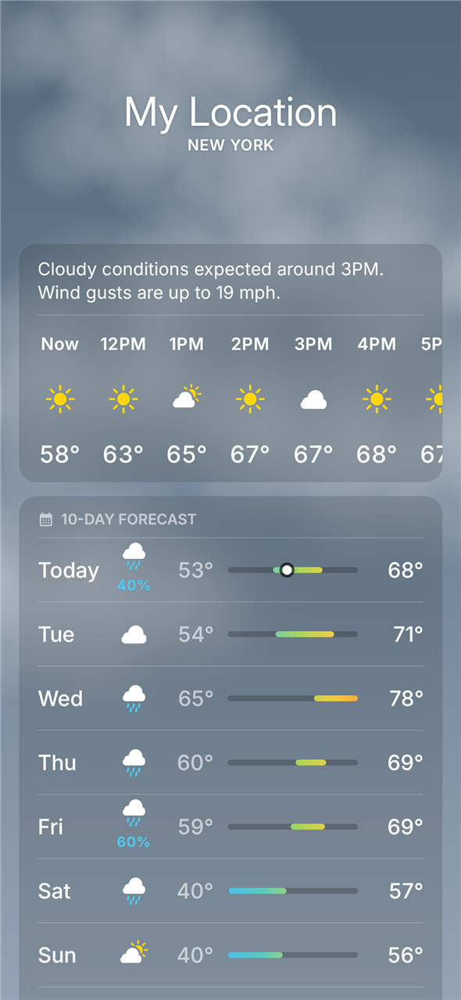
  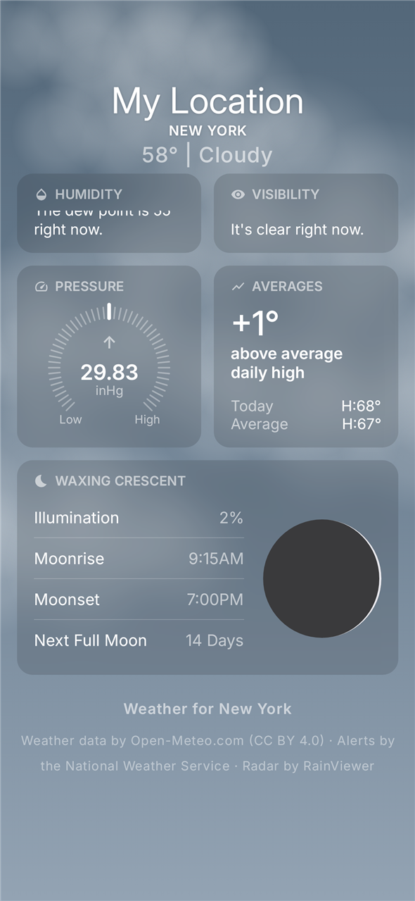
  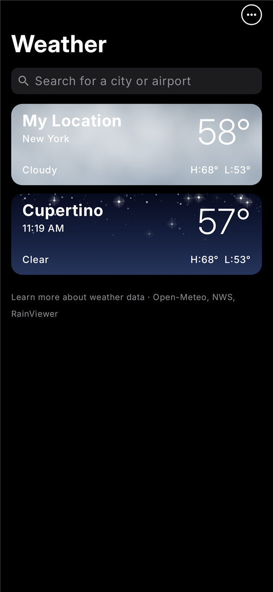
</p>

### Detail sheets
Tap a card to open an iOS-style sheet with a 24-hour chart:
- **Pick a day** from the row of dates, or **swipe left/right** anywhere outside the chart to move between days.
- **Scrub the chart** by dragging sideways (or pressing and holding) to read any hour. The header shows the value, the time and a second reading such as "Feels Like 71°", gusts or chance of rain.
- Switch between Conditions, UV Index, Wind, Precipitation, Feels Like, Humidity, Visibility, Pressure and Air Quality from the menu.
- The Conditions chart shows both the actual and the Feels Like temperature.
- Daily summary, comparison with yesterday, and an explanation of each measurement.
- Pull the sheet down to close it.

<p>
  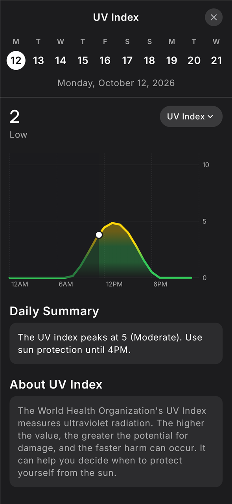
</p>

### Animated skies
The background matches the current weather and time of day: a glowing sun with shimmering rays and lens flare, drifting clouds in layers, rain and snow at three depths, fog, twinkling stars with the odd shooting star, warm sunrise and sunset, and thunderstorms with lightning.

<p>
  
  
  
  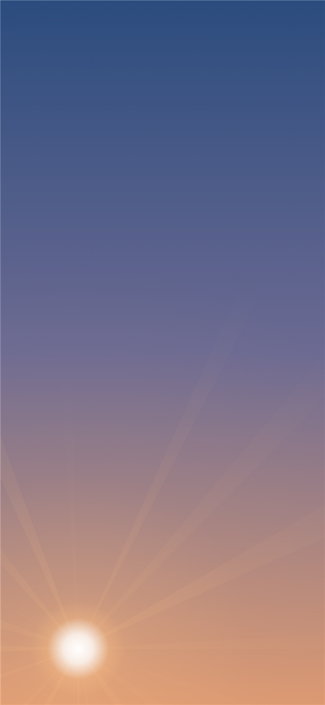
  
</p>
<p>
  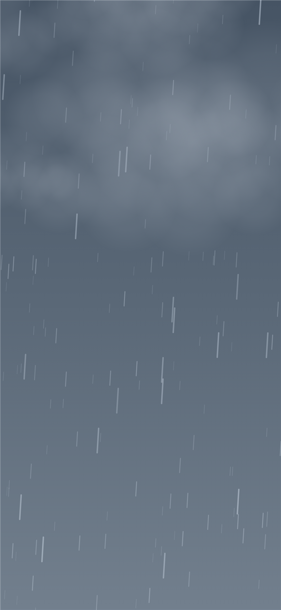
  
  
  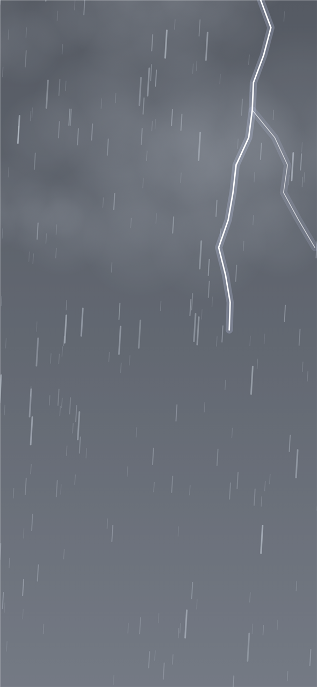
</p>

With the forecast on top:

<p>
  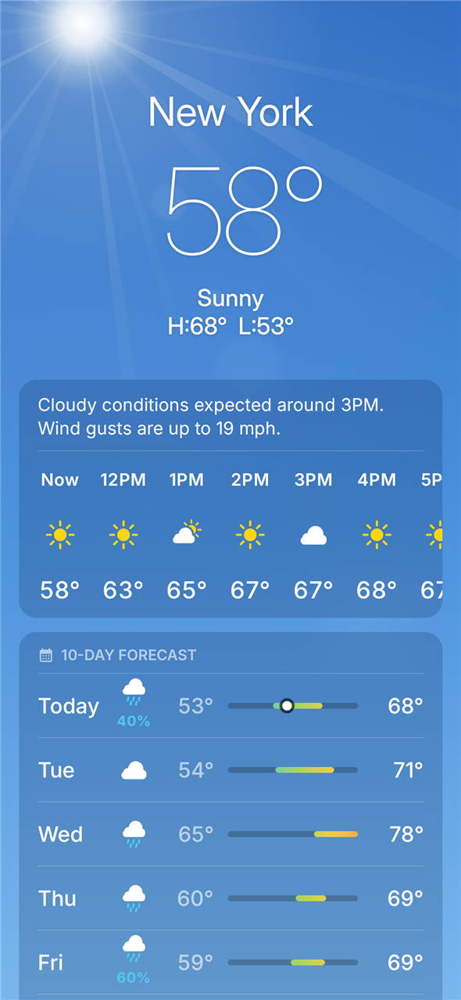
  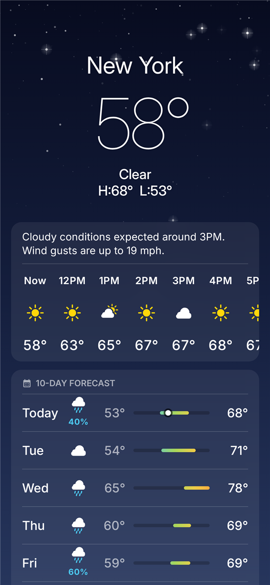
  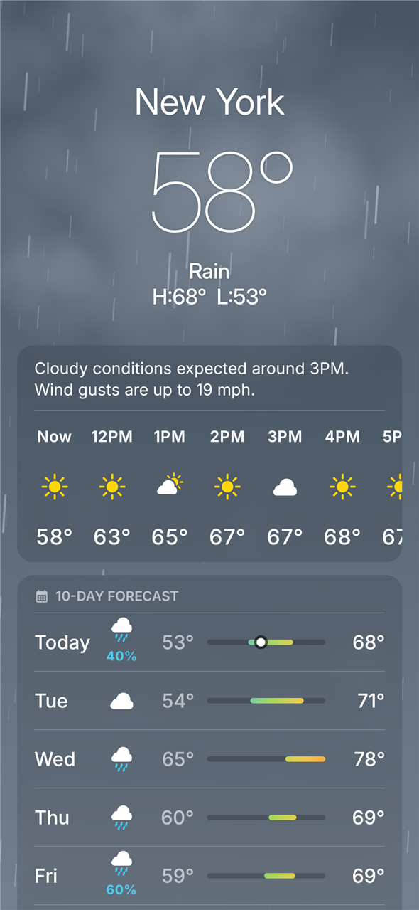
  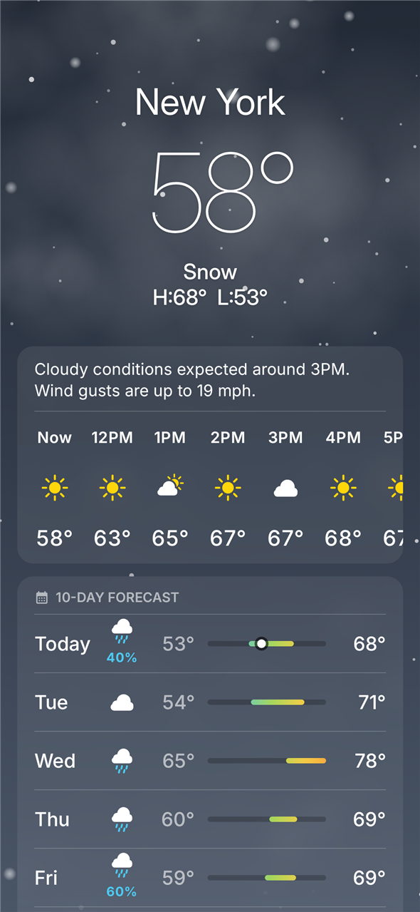
  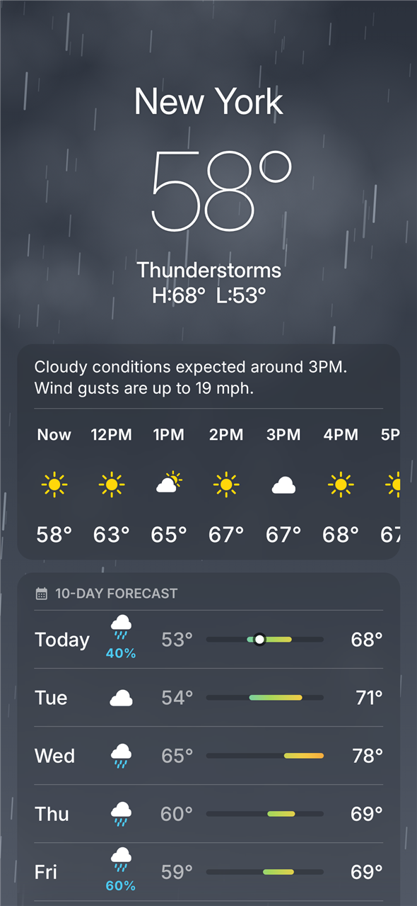
</p>

### Map
Full-screen map with a timeline slider:
- **Precipitation:** radar for the past two hours, then a 12-hour forecast.
- **Temperature**, **Wind** (with direction arrows) and **Air Quality** layers, each with a legend.
- Markers for your saved locations.

### Locations
Search for any city, preview it before adding, reorder or swipe to delete, and use your current location. Settings for Celsius/Fahrenheit and units (wind, precipitation, pressure, distance) are in the ⋯ menu.

### Severe weather alerts
Official alerts for the **United States** (NWS), **Canada** (Environment Canada) and **38 European countries** (MeteoAlarm), shown at the top of the page with full details.

### Notifications
Optional, from ⋯ → Notifications:
- Severe weather alerts
- Rain starting within the next hour
- A morning forecast at the time you choose

### Home-screen widgets
Four widgets, styled after Apple's: **Small**, **Medium** (hourly), **Large** (hourly and daily), and **At a Glance** (date and a weather line). Add them from your launcher's widget picker or from ⋯ → Add Widget in the app.

## Adding Stratus to Pixel's At a Glance

Google doesn't let other apps put weather into the Pixel's built-in At a Glance. The workaround is **[Smartspacer](https://github.com/KieronQuinn/Smartspacer)**, a free app that replaces At a Glance and accepts plugins. Stratus includes a Smartspacer plugin.

1. **Install Smartspacer** from the [Play Store](https://play.google.com/store/apps/details?id=com.kieronquinn.app.smartspacer) or its [GitHub releases](https://github.com/KieronQuinn/Smartspacer/releases).
2. **Set it up** by following its setup screens. To replace the Pixel's own At a Glance, turn on Smartspacer's native mode, which uses Shizuku. Its [setup guide](https://github.com/KieronQuinn/Smartspacer/wiki) has the details. Without native mode, you can use Smartspacer's own At a Glance widget on your home screen instead.
3. **Open Stratus once** and allow location, so it has weather to show.
4. In Smartspacer, open **Complications → + → Stratus Weather**. This adds the temperature and condition icon next to the date (for example "☁ 58°").
5. In Smartspacer, open **Targets → + → Stratus Alerts**. This adds a card for severe weather alerts or rain starting soon ("Rain starting in 12 min").
6. *Optional:* to avoid seeing the weather twice, turn off Google's own weather in At a Glance (long-press the home screen → Home settings → At a Glance).

Stratus refreshes Smartspacer whenever the weather updates, about every 15 minutes.

**Without Smartspacer:** add the **Stratus · At a Glance** widget to the top of your home screen. It looks like the Pixel's At a Glance, with the date and the current weather.

## Weather data

| Data | Source |
| --- | --- |
| Forecast, hourly and 10-day | [Open-Meteo](https://open-meteo.com) |
| Air quality | Open-Meteo (CAMS) |
| Averages | Open-Meteo historical weather |
| Radar | [RainViewer](https://www.rainviewer.com) |
| Map tiles | Esri, HERE, Garmin, OpenStreetMap contributors |
| Alerts | NWS (US), Environment Canada, MeteoAlarm (Europe) |
| City search | Open-Meteo geocoding |

## How it differs from Apple Weather

- **Font:** Apple's SF Pro can't be distributed, so Stratus uses [Inter](https://rsms.me/inter/) (SIL Open Font License, see `INTER-OFL.txt`), which looks very similar.
- **Icons and animations:** SF Symbols and Apple's animations can't be used outside Apple devices. Stratus draws its own in the same style.
- **Radar** goes back two hours (RainViewer's free limit). Future hours come from forecast model data.
- **Alerts** are available only where a free official feed exists (US, Canada, most of Europe).

## Building

Requires JDK 17+ and the Android SDK (compile SDK 37).

```bash
./gradlew assembleRelease
```

The APK is written to `app/build/outputs/apk/release/`. Screenshot tests (Robolectric) render the images in this README into `app/build/screens/`:

```bash
./gradlew testDebugUnitTest
```

Built with Kotlin, Jetpack Compose, Glance (widgets), WorkManager, [Haze](https://github.com/chrisbanes/haze) (blur), OkHttp, kotlinx.serialization and the Smartspacer plugin SDK.

## Disclaimer

Stratus is an independent project, not affiliated with or endorsed by Apple or Google.
